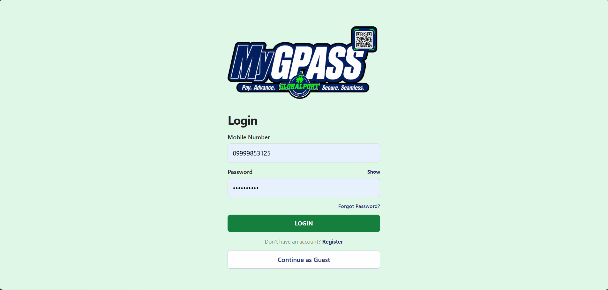
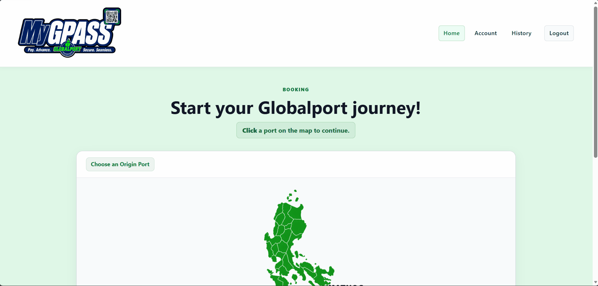
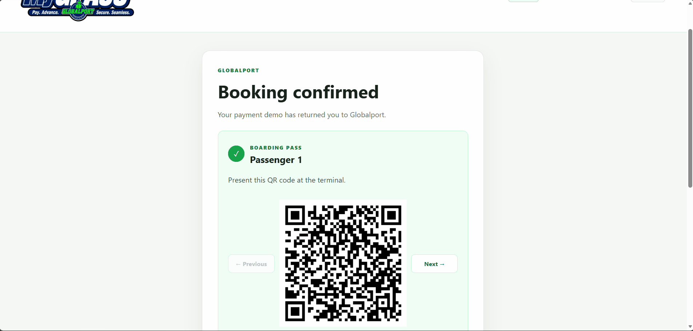
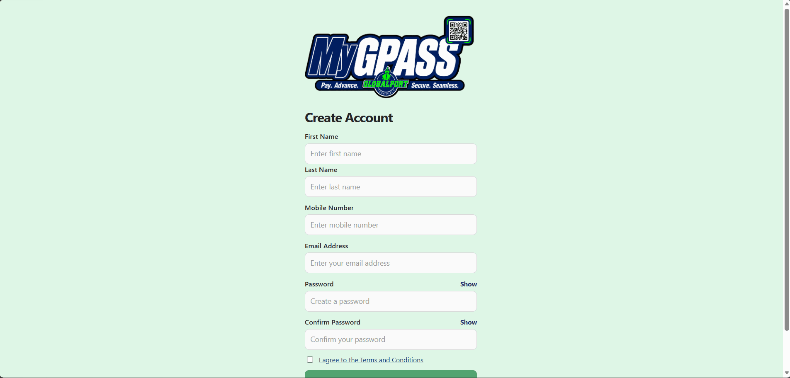
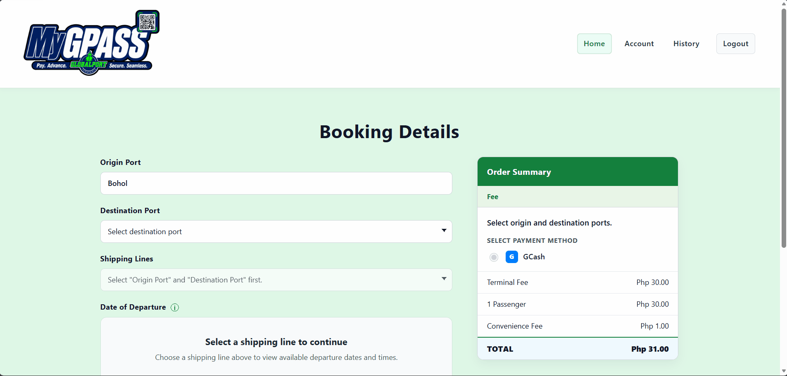
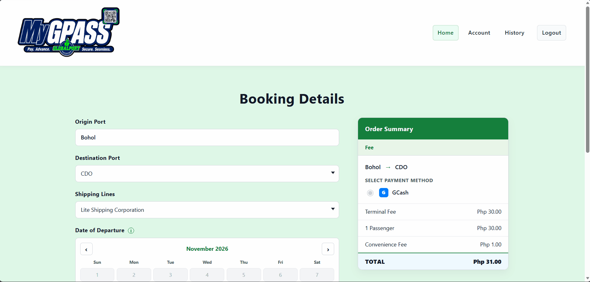
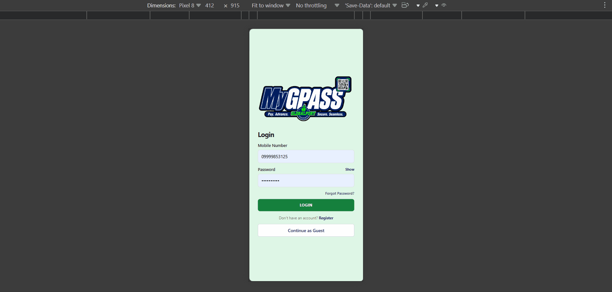

# MyGPASS

Full-stack passenger booking system. Angular 22 + ASP.NET Core 10. JWT auth, guest booking, QR passes, demo payment.

**Live:** [https://gpass.globalports.com.ph/login](https://gpass.globalports.com.ph/login)

---

## Demo

### Booking flow

| Feature | GIF | Steps |
|--------|-----|-------|
| **Guest booking** |  | Continue as Guest → select route on map → booking details → demo payment → pass with QR. |
| **Registered booking** |  | Register → login → route selection → details → payment → pass → view bookings. |
| **Route selection** |  | Click a port on the schematic Philippine map → choose terminal fee → proceed. |
| **Pass / QR** |  | One QR per passenger → download → view bookings (registered) or guest access. |

### Core features

| Feature | GIF | Steps |
|--------|-----|-------|
| **Auth** |  | Register → Login → Account/History. Forgot password + email verification. |
| **Booking details** |  | Shipping line, day of departure, ETD, passenger count. When a user changes the Origin or Destination port, the Shipping Line, Day of Departure, and Estimated Time of Departure fields are reset — they were based on the previous route. Passenger count stays unchanged. |
| **Payment (demo)** |  | Demo confirmation → ₱31.00 total → pass with QR per passenger. |
| **Responsive UI** |  | Mobile-friendly across all pages. |

Full test checklist: [docs/setup.md](docs/setup.md)

---

## Quick start

**Prerequisites:** .NET 10 SDK, Node.js 18+, SQL Server LocalDB

| Step | Backend | Frontend |
|------|---------|----------|
| Setup | `cd backend/MyGPASS.Api` → create `appsettings.Development.json` with `ConnectionStrings:GPassDb` → `MyGPASS_Public_Development` on `MSSQLLocalDB` | `cd frontend/mygpass-client` → `npm ci` |
| Database | Apply migrations `001–007` + `009` via `sqlcmd -I`, then insert fictional seed (see [docs/setup.md](docs/setup.md)) | — |
| Run | `dotnet run` → http://localhost:5000 | `npm start` → http://localhost:4200 |
| Test | `dotnet test` (58 tests) | `npm test` (75 tests) |

Verify: `GET http://localhost:5000/api/ports` returns Demo Port A and Demo Port B.

OpenAPI: http://localhost:5000/openapi/v1.json (development only)

Full setup and deployment details: [docs/setup.md](docs/setup.md)

---

## Documentation

| Document | Description |
|----------|-------------|
| [docs/setup.md](docs/setup.md) | Local demo setup, database, migrations, seed data, deployment |
| [README.md](README.md) | This file — overview, quick start, demo, doc links |

---

## Project structure

Detailed file tree: [docs/setup.md#project-structure](docs/setup.md#project-structure)

```text
MyGPASS-Public/
├── frontend/mygpass-client/     # Angular 22 frontend
├── backend/MyGPASS.Api/         # ASP.NET Core 10 Web API
├── backend/MyGPASS.Api.Tests/   # Backend tests
├── database/schema/             # Versioned SQL scripts
└── docs/                        # Setup and reference docs
```

---

## Features

- **Booking flow:** Route selection → Booking details → Demo payment → Digital pass with QR (one per passenger)
- **Guest booking:** No registration required; cryptographically secure guest tokens (SHA-256 hashed, expiration/revocation/ownership validated)
- **Authentication:** JWT-based login/register with email verification and password reset
- **Account & History:** Registered users can view past bookings and manage their account
- **Responsive UI:** Mobile-friendly across all pages
- **Security:** JWT validation, configured CORS, rate limiting, security headers (CSP, HSTS, X-Frame-Options), production-safe error handling, dependency vulnerability scanning (0 npm vulnerabilities)
- **Testing:** 75 frontend tests (Vitest) + 58 backend tests (.NET), production build passing
- **Database:** SQL Server / Azure SQL with versioned migration scripts (no EF migrations)
- **VAPT:** VAPT-oriented hardening applied (JWT validation, CORS, rate limiting, security headers, dependency scanning). Baseline VAPT assessment completed by an external firm (Oct 2026). This is not a VAPT compliance or certification claim.

---

## Security & VAPT

- VAPT-oriented hardening: JWT validation, configured CORS, rate limiting, security headers (CSP, HSTS, X-Frame-Options), production-safe error handling, dependency vulnerability scanning (0 npm vulnerabilities).
- Baseline VAPT assessment completed by an external security firm (Oct 15–26, 2026). This documents the assessment cycle — not a VAPT compliance or certification claim.
- Demo payment only; real GCash production integration is not active.

---

## Tech stack

| Layer | Technology |
|-------|------------|
| Frontend | Angular 22, TypeScript, Vitest |
| Backend | ASP.NET Core 10, .NET 10 |
| Data access | Entity Framework Core |
| Database | SQL Server / Azure SQL (LocalDB for demo) |
| Auth | JWT bearer tokens |
| Security | CSP, HSTS, X-Frame-Options, CORS, rate limiting |

---

## License

MIT
